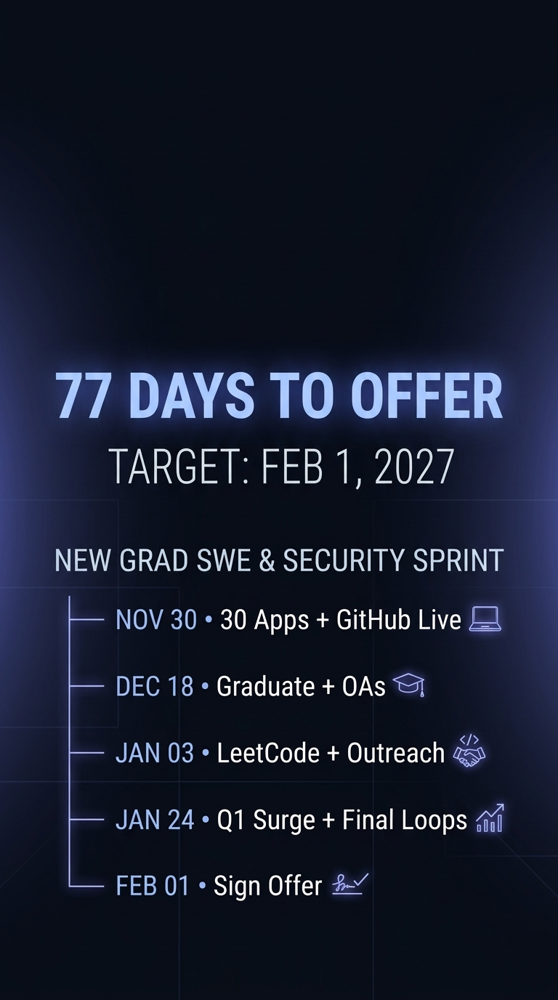
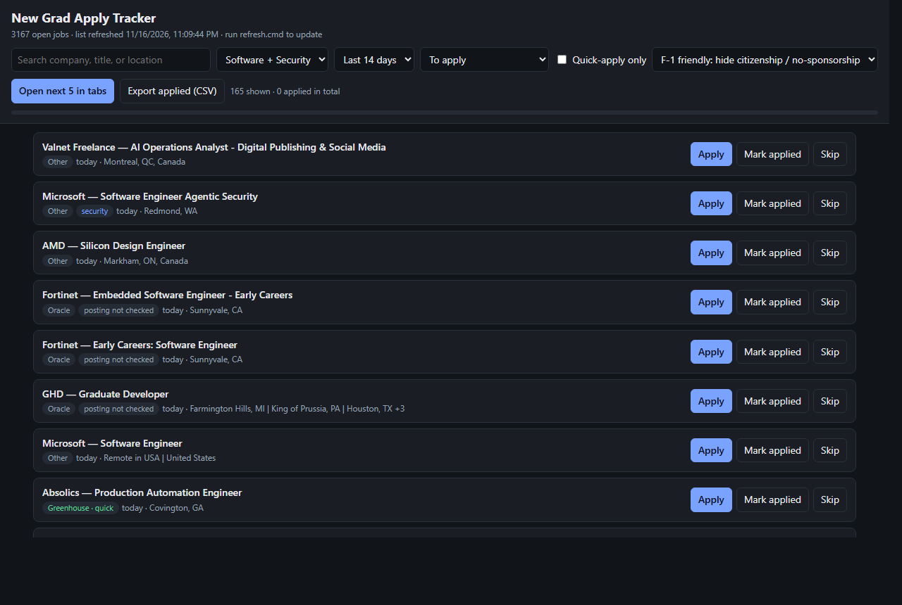

# 🎯 New Grad Offer Sprint & Apply Tracker (Target: Feb 1, 2027)

A local Node.js job aggregator, F-1 work-authorization scanner, and application tracker built to streamline my December 2026 graduation job search across **SimplifyJobs/New-Grad-Positions**—paired with a custom **Countdown Lock Screen** and daily sprint system.

---

## 📱 Countdown Lock Screen & Milestone Plan (77 Days to Offer)



Working backward from **February 1, 2027**:
- **Nov 16 – Nov 30 (77 → 63 Days Left):** Publish tracker on GitHub, finalize SWE/Security resume, submit first 30 targeted applications.
- **Dec 1 – Dec 18 (62 → 45 Days Left):** Graduate! Maintain 15+ tailored apps/week and complete early Online Assessments (OAs).
- **Dec 19 – Jan 3 (44 → 29 Days Left):** Winter break LeetCode, system design, and security prep + 15 alumni/recruiter outreach messages.
- **Jan 4 – Jan 24 (28 → 8 Days Left):** Capitalize on Q1 hiring surge (20+ apps/week) and complete final-round interview loops.
- **Jan 25 – Jan 31 (7 → 1 Day Left):** Evaluate offers, negotiate compensation, and sign before Feb 1.

**Daily Reminder Cadence:**
- **Daily @ 7:00 PM:** *"New Grad Tracker: Open Next 5 & Apply to 3 Roles"*
- **Sundays @ 5:00 PM:** *"Run `node build.js` + Export Applied CSV Backup"*

---

## 💻 New Grad Apply Tracker & Work-Authorization Scanner



### Key Features
- **Live Job Aggregation:** Pulls 3,167+ active roles from `SimplifyJobs/New-Grad-Positions` into a fast, zero-dependency local dashboard (`jobs.html`).
- **Automated Work-Authorization & F-1 Filter:** Scans job descriptions to detect citizenship/clearance mandates (319 roles) and explicit no-sponsorship clauses (179 roles), hiding 498 restricted postings by default while surfacing the exact matched quote to prevent false positives.
- **Role & Recency Filtering:** Filters down to recent **Software + Security** postings, supports batch tab opening (`Open next 5 in tabs`), local progress tracking (`To apply` / `Applied` / `Skipped`), and one-click CSV export.
- **Tested Classifier:** Verified with 27 passing unit tests (`node build.js` regenerates the full dataset and dashboard end-to-end).

### Quick Start
```bash
git clone https://github.com/PraveshAryal03/new-grad-apply-tracker.git
cd new-grad-apply-tracker
node build.js
# Open jobs.html in your browser
```
